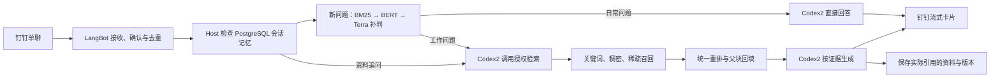

# WorkRAG｜工作知识助手

面向行政、IT 和财务等内部资料的钉钉知识助手。员工可以在单聊中查询操作流程、查看来源与配图，或接着上一轮询问同一份资料。管理员在本机整理图文资料、审核分块和发布版本。

## 系统架构



## 实现亮点

- **按流程组织资料**。父块对应章节或完整流程，子块对应步骤或完整说明。管理员可在发布前调整边界、顺序、页码和配图关系。查询命中子块后回填其父块，分别返回跨资料证据。
- **混合检索**。标题与关键词、BGE-M3 稠密向量、稀疏向量三路召回，使用 BGE-Reranker-v2-m3 统一重排。PostgreSQL 保存原文、版本与会话引用，Qdrant 保存可重建的检索索引。
- **可追问的图文回答**。卡片显示处理状态、真实增量和来源，支持已入库图片。会话记忆按单聊和员工隔离，有效期 24 小时。追问时重新核对发布状态和版本，必要时请员工选择资料。
- **工作与日常分流**。独立 BM25 样例索引和监督 BERT 负责本地分类，Terra 处理低置信度问题。日常路线不获得知识库权限。V3 接管范围可限定到指定机器人单聊，支持退回影子模式。钉钉接收端在消息入队后确认，短期内按消息 ID 去重。

## 开源组件与设计参考

| 组件 | 在 WorkRAG 中的用途 |
| --- | --- |
| [LangBot](https://github.com/langbot-app/LangBot) | 接收钉钉消息、管理运行器和授权。WorkRAG 在 Host 层实现意图分流、会话范围约束、卡片初始状态和消息去重。 |
| [MinerU](https://github.com/opendatalab/MinerU) | 解析文档并导入 Markdown、页码及图片。WorkRAG 将提取结果整理成可审核的章节和流程。 |
| [PostgreSQL](https://www.postgresql.org/) 与 [Qdrant](https://github.com/qdrant/qdrant) | 分别保存权威资料和可重建的向量索引。 |
| [Dify](https://docs.dify.ai/en/cloud/use-dify/knowledge/create-knowledge/chunking-and-cleaning-text) | 父子分块交互的设计参考。WorkRAG 独立实现流程边界编辑、发布前预览和父块上下文回填。 |

## 当前成果

| 指标 | 本机试点结果 |
| --- | --- |
| 资料规模 | 13 条记录，11 条已发布并完成索引。索引条目涉及 2 个已命名分类，也包含未归类条目与演示资料。 |
| 检索 Hit@5 | **15/15（100%）**，小样本有依据题。 |
| 跨资料证据覆盖 | **6/6** 个目标证据，来自 3 道跨资料题。 |
| 无依据题正确返回证据不足 | **3/5**，另 2 道返回了不适用的资料。 |
| 检索耗时 | **平均 9.59 秒，P95 16.67 秒**，20 道预标注问题，预热后单并发。 |
| 意图分类 | V3 合成留出集，本地自动接受准确率 **97.0%（128/132）**，明确问法覆盖率 **97.6%（121/124）**。 |
| 钉钉端到端 | 已核实一次真实工作问题约 **120 秒**，从收件到最终卡片更新成功。样本不足 10 条，暂不报告平均值。 |

题量、分母、失败类型与耗时口径见 [脱敏评测报告](docs/evaluation.md)。

## 本地运行

准备 Python 3.11、独立 PostgreSQL 数据库和角色 `manual_rag`、本机 Qdrant，以及 BGE Embedding 和 Rerank 服务。可以用 [配置示例](instances/manuals/.env.example) 创建本地 `instances/manuals/.env`。填写本机数据库凭据和独立图片签名密钥，从仓库根目录执行以下命令。

```powershell
python scripts/manual-instance.py init
python scripts/manual-instance.py serve
```

知识管理界面在 `http://127.0.0.1:8060/knowledge/`。LangBot 需要另行部署和设置 CodexAgent、机器人及工作知识库绑定。部署顺序和配置边界见 [本地部署说明](docs/deployment.md)。代码与示例可用于部署，业务资料、模型权重及运行凭据由部署方保管。
