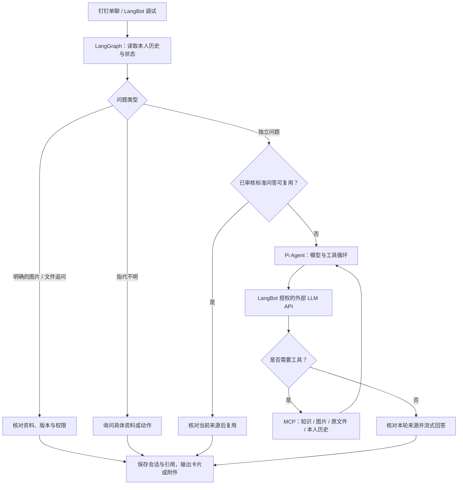

# WorkRAG 工作知识助手

基于 **LangBot＋LangGraph＋Pi Agent** 的工作资料检索助手。员工可以在钉钉中查询工作资料、获取操作步骤，并继续索取相关图片或原文件。管理员在 WorkRAG 中管理资料，在 LangBot 中配置模型、工具授权和标准问答审核。

当前问答引擎插件 **0.4.2**，Pi 核心 **1.5.0**。`main` 已同步当前助手源码和整理后的目录；`full-project` 保留开发来源。本仓库提供源码、配置示例与部署说明，企业资料、数据库、模型权重和实际密钥由部署者在本机准备。

[使用说明](docs/current/agent-README.md) · [环境与目录](docs/current/项目目录与Python环境.md) · [部署工具](deployment/README.md) · [全部文档](docs/README.md) · [当前交接](docs/current/给下一聊天的接手说明.md)

## 快速开始

### 当前机器：启动与关闭

已经配置好的机器直接双击根目录的 `start-knowledge.bat`。其他日常入口：

| 操作 | 入口 |
|---|---|
| 启动 | `start-knowledge.bat` 或 `start-local.ps1` |
| 查看状态 | `status-local.ps1` |
| 重启 | `restart-knowledge.bat` |
| 关闭项目并检查残留进程 | `stop-knowledge.bat`；加 `--check` 只查看 |

真正的 Python 入口是 **`deployment/local.py`**，使用项目的 **`.venv`**，无需 Conda。从项目根目录运行：

```powershell
.\.venv\Scripts\python.exe deployment/local.py start
.\.venv\Scripts\python.exe deployment/local.py status
.\.venv\Scripts\python.exe deployment/local.py stop
```

启动后访问：

- **资料管理**：<http://127.0.0.1:8060/knowledge/>
- **LangBot 管理与调试**：<http://127.0.0.1:5300>

### 新机器：获取代码

```powershell
git clone --branch main https://github.com/Daer-233/WorkRAG.git
cd WorkRAG
```

新克隆的仓库需要先准备 Python、Node.js、Docker、模型、数据库和本地配置，按下方[环境与首次部署](#环境与首次部署)完成安装。现有一键入口用于已配置的部署；复制代码不会恢复另一台机器的资料或登录状态。

## 工作流



**LangGraph** 负责记忆、标准问答复用、确定性资料追问与最终校验；**Pi** 负责内部模型／工具循环。模型继续使用 LangBot 中选择的 API 模型，不把模型密钥复制到 Pi。当前本机使用 deepseek-flash，也可另行配置兼容且支持工具调用的模型，换模型后须重新验收。

## 当前功能

- 资料上传、解析、发布、索引和检索；使用 Qdrant、BGE-M3 与 BGE-Reranker-v2-m3。
- 日常问答、工作资料检索、本人历史查询、模糊指代澄清。
- 已确定单份资料后，回复“图片”“文件”或“下一步”继续查询；多资料或过期状态先澄清。
- 员工正文只保留资料名称、操作和必要页码，隐藏版本号、证据 ID 和内部检索说明；后台仍保留完整引用供审核和附件定位。
- 外部模型真实流式输出；当前钉钉旧模板支持默认折叠的图片区，每轮最多 3 张图，原文件通过原生附件通道返回。
- 明确反馈进入候选，管理员审核后发布标准问答；BM25 用于召回，满足保守复用条件后才直接回答。
- PostgreSQL 独立工作流库、签名工具范围、显式资料白名单、用户隔离与调用限制。

默认每轮最多 6 次工具调用、180 秒，Agent 请求最多 2 个并行、32 个等待；个人聊天默认保留 90 天，已发布标准问答独立保存。Pi 仅有四个只读工具，不开放终端、任意文件写入或业务审批工具。

### LangBot 入口对照

| 入口 | 用途 |
|---|---|
| 调试助手 | 直接测试模型、资料检索、追问和反馈 |
| 问答流水线 | 设置触发条件、运行器和输出，由机器人绑定 |
| 问答引擎插件 | 提供 LangGraph＋Pi Runner、审核 Page 和入口说明 |
| 资料检索工具（原 WorkRAGReadOnly） | 连接本机 WorkRAG MCP，提供四个只读工具 |
| WorkRAG 管理页 | 上传、核对、发布和索引原始资料 |

LangBot 左侧的备用知识库不等于已连接 WorkRAG。当前原始资料管理仍在 WorkRAG 页面完成。

## 技术与服务

| 服务 | 版本／职责 | 本机地址 |
|---|---|---|
| LangBot | 4.11.3；平台、模型授权、卡片与插件运行时 | http://127.0.0.1:5300 |
| WorkRAG | 资料管理与检索 API | http://127.0.0.1:8060/knowledge/ |
| WorkRAG MCP | 四个只读工具 | 127.0.0.1:8061 |
| Pi worker | pi-agent-core 1.5.0，Node.js 服务 | 127.0.0.1:8062 |
| PostgreSQL | 16.11；manual_rag / workrag_agent 分库 | 127.0.0.1:5432 |
| Qdrant | 1.16.3；manual_rag_chunks_v1 | 127.0.0.1:6333 |
| Embedding / Rerank | BGE-M3 / BGE-Reranker-v2-m3，CPU 推理 | 127.0.0.1:8031 / 8032 |

## 环境与首次部署

当前机器使用项目独立 **venv，不用 Conda**。解释器为 `G:\项目\WorkRAG\.venv\Scripts\python.exe`，Python **3.11.16**。PyCharm 请选“已有虚拟环境”并指向该文件；无需新建或切换 Conda 环境。详细配置见 [Python 环境与目录导航](docs/current/项目目录与Python环境.md)。

当前启动脚本面向 **Windows＋WSL 2＋Docker Desktop、Python 3.11、Node.js ≥22.19**。现有部署代码位于 `G:\项目\WorkRAG`，Docker、模型和容器数据位于 `G:\docker`；换机器时先调整部署脚本中的绝对路径。本仓库不是跨平台的一键安装包。

首次部署请阅读 [本机部署说明](deployment/README.md)、[问答引擎配置说明](docs/current/agent-README.md) 和 [Pi 接入与验收](docs/current/Pi-Agent接入与验收.md)。需要准备：

1. Docker Desktop／WSL 2、Python 环境和 Node.js，安装 Python 依赖并单独准备合适的 CPU PyTorch。
2. 在 `apps/pi-harness` 执行 `npm ci --ignore-scripts`，安装 lockfile 固定的 Pi 依赖。
3. 按部署说明生成本机私有配置，启动 `deployment/compose.yaml` 对应服务；下载两套 BGE 模型，初始化资料库和独立工作流库。
4. 构建、安装 LangBot 插件，在模型页填入自己的 API 配置，给处理器选择模型并授权四个 MCP 工具与资料 ID。
5. 导入并发布资料，先在调试助手验收，再绑定自己的机器人和模板。正式部署前自行核对平台凭据、权限与收件范围。

Pi 随启动器启停。LangBot 插件使用 Docker 内的 Python 环境，本机 WorkRAG、模型和 MCP 服务使用项目 `.venv`；Pi 本身是 Node.js 服务。切换或回退两个处理器的内部 Agent 引擎：

```powershell
.\.venv\Scripts\python.exe deployment/select_agent_engine.py pi --target both
.\.venv\Scripts\python.exe deployment/select_agent_engine.py legacy --target both
```

两个处理器分别保存配置。不要重复运行初始化处理器脚本覆盖已配置的模型。只导入 `.lbpkg` 不会安装 Node 服务或恢复数据库、资料与私有凭据。

## 验证与当前边界

目录整理后已检查文件引用、Python 与 PowerShell 入口语法、文档链接，以及 9 项离线卡片兼容测试；实际服务健康检查和真实 DeepSeek＋MCP 流水线检索也已通过。验收脚本集中在 [deployment/checks](deployment/checks/README.md)，离线测试在 [deployment/tests](deployment/tests/README.md)。部分验收脚本会调用真实 API、临时修改测试配置、重启服务或向指定单聊投递测试消息，应按各自说明运行。

本轮本机检查覆盖真实 DeepSeek／MCP 问答、图片和原文件追问、本人历史、无证据、工具授权拒绝、调用上限、超时取消与 Pi 重启恢复。另有实际 SDK 契约和工作流／附件测试；具体口径与历史记录见 [Pi 验收说明](docs/current/Pi-Agent接入与验收.md)。这些功能性检查不代表生产准确率或并发压测结论，历史评测见 [原评测记录](docs/history/knowledge/evaluation.md)。

用户已在本人钉钉单聊确认旧模板正文、分段输出、图片默认收起／展开／放大和演示 DOCX 收件。最新正文更新优化已获得平台接口成功，客户端最终显示仍须实测；不能把接口受理当作收件或渲染成功。

尚未完成：

- 正式企业资料接入；当前验收资料明确标注为虚构演示，不能作为真实公司制度。
- 真实钉钉点赞／点踩可信回调和原生图片／文件选择按钮；当前支持文字选择、语言反馈和模拟回调。
- 普通成员完整登录验收、生产级部门身份映射与权限隔离联调。
- LangBot 内原始资料上传／发布一体化页面、拖拽工作流编辑器。
- 当前 Pi 助手的付款审批及其他业务写操作。仓库保留的 payment-mcp、Milvus、Codex Host 和意图分类实验属于历史模块，不代表已接入当前流水线。
- 模型轮次与上下文提速：合并分类和工具决策、缩短内部规划结果、压缩重复工具内容已形成计划，尚未上线；当前版本不承诺固定的响应秒数。

## 目录与文档

```text
apps/backend/        WorkRAG API、资料处理与检索
apps/manual-web/     资料管理前端
apps/embedding/      BGE-M3 服务
apps/rerank/         重排服务
apps/workrag-agent/  LangGraph、Pi 适配、MCP、存储及输出过滤
apps/pi-harness/     Pi Node worker 与固定依赖
plugins/WorkRAGGraph/ LangBot Runner、审核与说明页面
deployment/          日常启停、部署配置与运行兼容模块
deployment/checks/   联调、诊断及验收工具（部分会改配置或发送测试消息）
deployment/tests/    模拟接口的离线兼容测试
docs/current/        当前使用说明、环境、架构与交接
docs/history/        按主题分类的历史方案与验收记录
docs/guides/         仓库上传等参考说明
scripts/             旧工具及仍共用的资料初始化／导入辅助脚本
instances/           配置示例与本地实例配置
data/                本机资料、私有配置及运行记录（忽略提交）
.venv/               本机 Python 虚拟环境（忽略提交）
```

- [当前交接入口](docs/current/给下一聊天的接手说明.md)
- [Pi 架构、限制、验收和回退](docs/current/Pi-Agent接入与验收.md)
- [旧模板空白正文与更新方式修复](docs/current/旧模板空白正文修复.md)
- [插件使用说明](plugins/WorkRAGGraph/README.md)
- [实施计划与历史记录](docs/current/WorkRAG实施计划与交接_2026-11-08.md)

完整分类入口见 [文档目录](docs/README.md) 和 [部署工具目录](deployment/README.md)。部分历史文档记录旧机器路径、旧 Agent、A2UI 或实验功能，以当前交接说明和实际配置为准。A2UI 新卡片当前停用，已有旧模板继续使用。

## 数据与密钥

实际 `.env`、模型密钥、内部令牌、数据库、企业原件、截图、备份、运行日志和依赖缓存不随代码上传。`.gitignore` 排除 `data/`、`backups/`、`artifacts/`、`.venv/`、`node_modules/` 等目录；配置模板使用占位值。克隆仓库不能恢复本机企业资料或登录状态。
