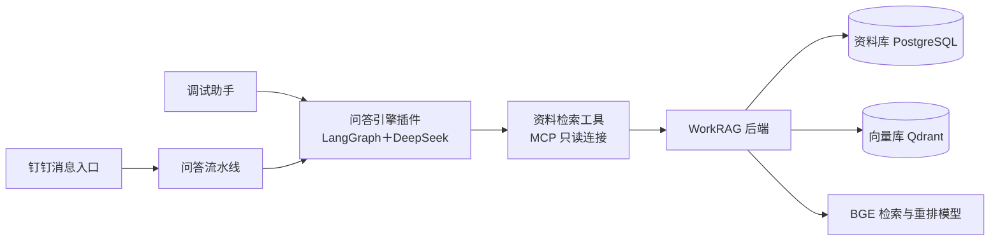

# LangBot 与 WorkRAG 入口对照

当前助手的连接方式是：

图中的钉钉是后续消息投递路径；本轮验证使用本机调试和流水线诊断入口，真实钉钉卡片、附件投递仍待联调。

## 改名对照

| 左侧栏目 | 原名称 | 当前名称 | 作用与使用场景 |
|---|---|---|---|
| 机器人 | 钉钉 | 钉钉 | 平台收发入口。机器人不是知识库或工作流代码 |
| 处理器，机器人图标 | 工作知识助手 · 本机验收 | **调试助手** | 在 LangBot 调试文字问题、工具调用和反馈事件 |
| 处理器，齿轮图标 | 工作知识助手 · 流水线验收 | **问答流水线** | 设置触发、安全控制、运行器、模型、工具授权和输出；供机器人后续绑定 |
| 已安装扩展，插件图标 | 工作知识助手 | **问答引擎插件** | 提供 LangGraph 工作流、会话记忆和审核页面；被上面两个处理器使用 |
| 已安装扩展，连接图标 | WorkRAGReadOnly | **资料检索工具** | MCP 连接，给引擎提供只读资料及个人历史工具；不是上传资料的入口 |
| 知识库 | 工作知识库 | **工作知识库（备用）** | 未完成配置的 HTTP 知识库入口，当前新助手不使用 |
| 知识库 | design知识库 | **design知识库（备用）** | 保留的旧 HTTP 知识库入口，未完成配置，当前新助手不使用 |
| 已安装扩展 | HTTP RAG 连接器 | HTTP RAG 连接器 | 为备用 HTTP 知识库提供连接能力，当前 MCP 方案不依赖它 |
| 插件页面 | 标准问答审核 | 标准问答审核 | 审核反馈产生的候选答案，发布后才可复用 |
| 插件页面 | 无 | **入口说明** | 本对照说明及 WorkRAG 管理页地址 |

“处理器”是 LangBot 的统称，里面既可以放对话 Agent，也可以放完整流水线。因此两个入口图标和配置界面不同，但目前调用的是同一个问答引擎插件。

## 知识库具体怎么连接

问答引擎通过 LangBot 已授权的 MCP 连接调用四个工具：

| 工具 | 读取内容 |
|---|---|
| search_knowledge | WorkRAG 中已发布、索引完成且在白名单内的资料 |
| get_document_images | 指定资料和版本的图片引用，或已确认步骤的下一步 |
| get_source_file | 指定资料和版本的原文件引用 |
| search_my_history | 当前用户自己的聊天历史，保存在独立工作流数据库 |

容器内的 MCP 连接地址为 `http://host.docker.internal:8061/mcp`；它调用本机 WorkRAG 后端 `8060`。WorkRAG 的 PostgreSQL 保存资料状态与记录，Qdrant 保存向量，BGE 服务提供向量与重排。个人聊天、候选问答和工作流检查点在独立 `workrag_agent` 数据库中。

截至此次核对，左侧两个备用知识库均为 `initialized=false`，HTTP API 地址和检索端点为空。它们没有自动指向 WorkRAG，也不会因为名字叫“工作知识库”就成为当前助手的数据源。

## 哪些事情可以在 LangBot 管理

| 要做的事 | 去哪里 |
|---|---|
| 更换 DeepSeek 模型、修改提示词 | 调试助手或问答流水线的 AI 能力配置 |
| 设置触发条件、安全控制和输出 | 问答流水线 |
| 检查 MCP 是否连接、查看四个工具说明 | 资料检索工具；其“文档”中已写入用途说明 |
| 调整哪些资料允许助手检索 | 对应处理器中的“授权资料 ID”数组 |
| 查看、编辑、发布、驳回和下架标准问答 | 标准问答审核 |
| 上传原件、解析、发布、索引或修改资料 | **WorkRAG 资料管理页** |
| 查阅这些入口的区别 | 入口说明 |

当前没有把 WorkRAG 的上传、发布和索引操作做成 LangBot 原生知识库管理功能。LangBot 中新增的“入口说明”提供导航和对照，实际资料操作仍由 WorkRAG 页面处理。

## 日常操作顺序

1. 打开 [WorkRAG 资料管理](http://127.0.0.1:8060/knowledge/)，上传资料并完成解析。
2. 核对内容后发布、建立索引。
3. 将要开放的资料 ID 加入“调试助手”的授权列表，先测试问答与来源。
4. 需要流水线也能查询时，同步调整“问答流水线”的授权列表。两处配置分别保存。
5. 用户反馈产生的候选在“标准问答审核”中处理；标准问答与原始资料是两类管理对象。

仅上传资料不会自动授权给助手。当前仅授权合成验收示例；部门身份映射、真实钉钉卡片与文件投递留待后续。

## 常用链接

- [LangBot 入口说明](http://127.0.0.1:5300/home/plugin-pages?id=workrag%2FWorkRAGGraph%2Fguide)
- [调试助手](http://127.0.0.1:5300/home/agents?id=baa3c4d7-366d-44b4-a38f-260b6d3b6e9e)
- [问答流水线](http://127.0.0.1:5300/home/agents?id=28ff66c2-04c2-4cfd-9bff-8b7a9f4efd5c)
- [资料检索工具](http://127.0.0.1:5300/home/mcp?id=%E8%B5%84%E6%96%99%E6%A3%80%E7%B4%A2%E5%B7%A5%E5%85%B7)
- [标准问答审核](http://127.0.0.1:5300/home/plugin-pages?id=workrag%2FWorkRAGGraph%2Freview)
- [WorkRAG 资料管理](http://127.0.0.1:8060/knowledge/)

这次改名保留各入口原有 UUID、DeepSeek 选择、资料白名单和工具授权。启动脚本按 MCP 的 UUID 查找连接，避免再次改名导致连接失效。内部插件标识 `workrag/WorkRAGGraph`、运行器标识和数据库名保持技术用途，界面显示名与它们不要求一致。
