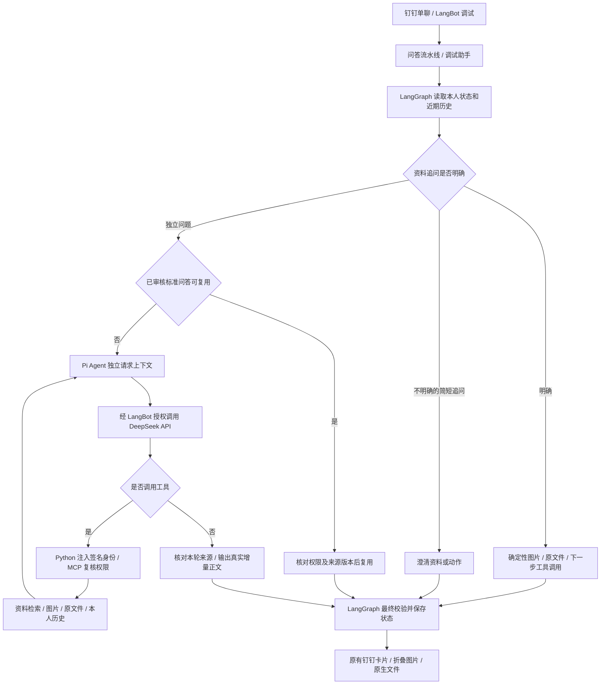

# Pi Agent 接入与验收

更新日期：2026-11-08。项目：G:\项目\WorkRAG。

## 最新员工显示调整（0.4.2）

普通答复只显示资料名称、操作和必要页码。版本号、证据 UUID、内部检索说明和本机图片链接不发给员工；模型最终回答提示、来源前缀及 Runner 的流式／最终展示层都已调整。实际设备编号、工单号和演示资料的虚构标记保留。

后台结构化 refs 和检查点完整保留版本、证据标识，用于来源有效性、授权检查、图片与原文件关联；没有删除资料或降低校验。历史／已审核答案的旧显示格式也经过同一输出过滤。

本轮 4 项显示过滤测试、8 项附件测试和 15 项实际 SDK 契约通过；真实 DeepSeek/MCP 的 7 项验收包括普通回答隐藏字段后继续取图和取文件。正式流水线记录见 pi-pipeline-acceptance.json。无需更换钉钉模板。

## 实现范围

问答引擎插件 **0.4.1** 使用官方 earendil-works/pi 的 **pi-agent-core 1.5.0** 替换内部 Agent 模型／工具循环。外层 LangGraph 继续管理状态，不是删除 LangGraph。模型使用 LangBot 已配置的 deepseek-flash，无需另填模型密钥。



短句“图片”“文件”“下一步”在资料唯一且有效时沿用确定性流程，无需每次交给 Pi。模糊的“需要”不会擅自选择图片。标准问答复用、反馈候选、人工审核、90 天历史清理继续沿用原实现。

## 部署及权限

| 部分 | 当前安排 |
|---|---|
| Node 服务 | apps/pi-harness/server.mjs，127.0.0.1:8062 |
| Python 适配 | apps/workrag-agent/workrag_agent/pi_model.py |
| 容器访问 | ws://host.docker.internal:8062/run，独立内部传输令牌 |
| 模型调用 | Runner 的本轮 LangBot 授权接口；不复制 API 密钥 |
| 工具调用 | Runner 拥有授权的任务执行；服务端签名身份和资料白名单 |
| 请求边界 | 每次新建 Pi Agent；无全局对话、ctx 或运行授权 |
| 限制 | 默认 6 次工具、180 秒、2 请求并行、32 个等待请求；Node 额外设置 190 秒兜底 |
| 取消 | 外层超时取消模型调用、关闭 WebSocket，Pi 中断并释放待处理 RPC |
| 卡片 | 沿用用户当前旧模板；正文兼容、3 张图默认折叠及文件通道继续保留；A2UI 停用 |

Pi 只开放四个只读 MCP 工具，不附带终端、任意文件写入、管理 MCP 或付款审批工具。模型不能指定用户身份、运行签名、收件人或任意本机路径。

知识工具计划不展示给用户；取得本轮证据、检查来源后，最终答案通过 LangBot 模型流式生成并实时转发。日常问题直接转发正文增量。不会将整轮答案完成后人为逐字播放。

## 启停与回退

正常使用原 start-knowledge.bat、start-local.ps1、status-local.ps1、stop-local.ps1。启动器已接入 Pi 服务，状态显示新增 pi-harness。

从项目根目录切换两个处理器：

```powershell
.\.venv\Scripts\python.exe deployment/select_agent_engine.py pi --target both
# 如需恢复原 Agent 循环：
.\.venv\Scripts\python.exe deployment/select_agent_engine.py legacy --target both
```

也可以在对应处理器的“Agent 引擎”中填 pi 或 legacy。两个处理器分别保存配置。选择脚本在修改前备份原设置，保留选中模型、工具、提示词及资料白名单，不会自动故障降级后重放请求。

Pi 私有令牌、进程记录、日志和验收结果在 data/manuals/runtime/agent-deployment，属于本地忽略目录，不要整目录对外分享。可安装插件为同目录 workrag-WorkRAGGraph-0.4.1.lbpkg；插件包不包含 Node 依赖，迁移机器时须在 apps/pi-harness 执行 npm ci --ignore-scripts，并启动本机服务。

## 验收记录

| 检查 | 本轮结果及证据 |
|---|---|
| 真实 Pi 核心 | npm test，3 项通过；显式模拟模型，非真实 API |
| 实际 SDK 与 Pi 服务 | verify_pi_contract.py，8 项模型兼容＋7 项 Pi 契约通过，覆盖任务授权、工具循环、限制、失败、取消和并发隔离 |
| 原工作流与附件 | test_workflow.py、test_media.py 共 39 项通过；独立测试数据库，含 Pi 上限分支 |
| 真实 DeepSeek＋MCP | verify_pi_real.py，7 项：日常、知识、图片、原文件、其他用户追问隔离、本人历史、无证据 |
| 真实发布前验证 | verify_pi_release.py，6 项：流式、工具拒绝、上限、超时清理、Pi 重启恢复、历史保留 |
| 正式流水线 | verify_pi_pipeline.py 检查两个处理器引擎、版本、真实检索结果及旧卡片开关，不向钉钉发送消息 |

机器记录：pi-real-acceptance.json、pi-release-acceptance.json、pi-real-stream.json、pi-pipeline-acceptance.json。真实流式一轮得到 189 个正文更新，约 8.3 秒结束；这是该次结果，不是响应时延承诺。模型通常按多个字的分块返回。

## 仍待完成

Pi 切换后用户尚需在本人钉钉单聊观察新问题的正文、图片折叠和文件收件；本轮本机调试的附件成功不替代客户端确认。切换前用户已确认旧模板正文、图片默认收起／放大及 DOCX 收到，文件能否打开未单独确认。原生等待态的彩色边框没有额外验收结论。

正式企业制度尚未提供，当前仍为明确标注虚构的演示资料。真实钉钉点赞／点踩可信回调、原生图片／文件选择按钮、普通成员完整登录验收、生产部门权限映射、LangBot 内原资料上传发布、业务写入及可视化工作流编辑器仍未完成。Pi 的接入不会自动补齐这些功能。
