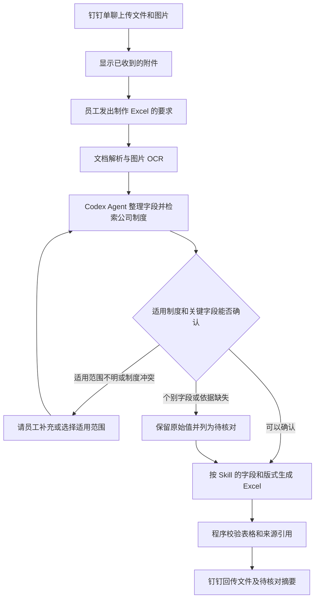

# 工作助手 Agent · 上传资料按制度生成 Excel

员工在钉钉单聊上传文件和图片，发出明确的制作要求。Agent 读取本次任务的资料，查阅适用的公司制度，生成可下载的 `.xlsx`，在回复中列出需要人工核对的事项。首个试点使用差旅报销明细。

> 把这几张发票和报销单整理成 Excel，按公司的差旅报销制度核对，列出需要我补充的材料。

| 环节 | 负责组件 | 处理规则 |
| --- | --- | --- |
| 收件 | LangBot 与工作助手后端 | 暂存当前员工和会话的附件，回复已收到的文件名及无法读取的文件。员工发出制作要求时固定本次文件清单，随后上传的材料进入下一批。 |
| 解析 | 工作助手后端 | 首批支持文本型 PDF、DOCX、XLSX、JPG 和 PNG。图片及扫描件走本地 OCR，保留文件名、页码或工作表与行号。看不清的字段留空并标记待核对。 |
| 查制度 | Codex2 Agent 与工作知识库 | 先按费用类别、发生日期和适用对象检索。依据来自已发布、适用范围可确认的资料，记录标题、版本、条款或页码。多个版本无法区分时请员工确认。 |
| 制表 | 制表 Skill 与后端生成工具 | Skill 定义字段、版式和核对规则。Codex 提交结构化明细、条款引用和待核对项。后端生成 Excel，核对行数、金额汇总、来源引用和可打开性。 |
| 交付 | LangBot 与钉钉 | 文件发送联调通过后，向发起任务的单聊回传 `.xlsx` 和简短摘要。交付失败时区分“表格已生成”和“钉钉发送失败”，支持重试交付。 |

报销试点的 Excel 包含三张工作表。

- **费用明细**记录日期、费用类别、原始金额、币种、来源位置、制度依据编号和核对状态。不同币种分别汇总。
- **制度依据**记录资料名称、版本、条款或页码、适用条件。明细中的判断可追溯到对应依据。
- **待核对事项**记录识别不清、疑似重复票据、缺失材料或证据不足的项目。疑似重复项保留并标记。表格用于整理和核对，报销审批仍由公司流程完成。

## 接入与验收顺序

1. **先跑通本机闭环。** 给 LangBot 的 Agent 类型处理器 Codex2 接入工作知识库与制表工具，用一份脱敏报销单、一张发票图片及适用制度，验证从解析到 Excel 生成。这个阶段通过本机受控入口取得文件。
2. **再接钉钉交付。** 在测试单聊验证分多次上传、图片识别失败、同名文件、其他员工无法读取本次任务，以及收到的 `.xlsx` 能打开。同步验证单聊的进度提示和失败提示。
3. **保留两种执行入口。** 第一版由现有 LangBot Codex 运行器执行。后续需要由工作助手直接管理 Agent 会话和流式事件时，可通过 Codex app-server 或 SDK 复用同一套解析、检索与制表工具。 [OpenAI Codex 集成说明](https://developers.openai.com/blog/codex-as-a-platform)

目前已有工作知识库、Codex 运行器和知识库图片卡片。要跑通该流程，还需要接入员工上传附件的读取、本地 OCR、Excel 生成工具及钉钉文件回传，并在 Codex2 上验证授权和调用。
